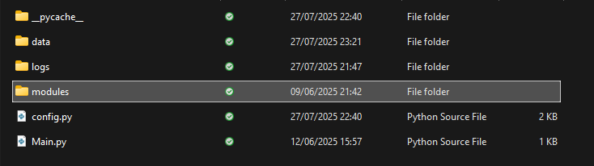
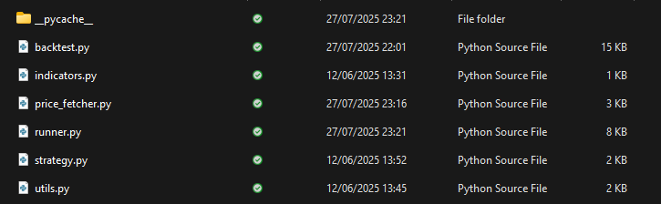
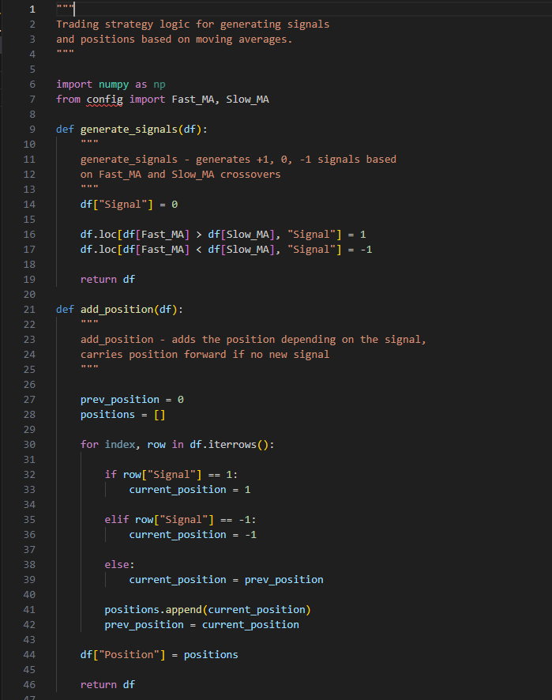
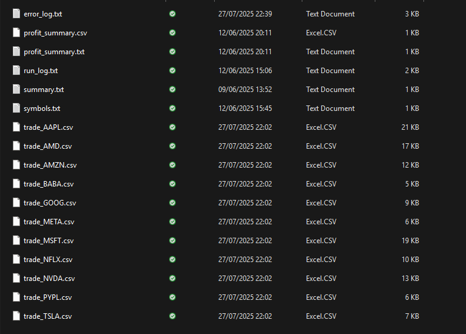

# Algorithmic Trading and Backtesting System

**Independent Python project | Historical market data | Strategy simulation**

A modular Python application that downloads historical equity prices, calculates technical indicators, generates long/short trading signals, simulates trades and exports transaction logs.

The objective was to design a **traceable research and backtesting pipeline**, not a live trading bot or a machine-learning price predictor.

**Tools:** Python · pandas · NumPy · yfinance · Alpha Vantage · requests



*Original architecture diagram from the project documentation.*

## 1. Project objective

I wanted to turn a simple moving-average strategy into a complete workflow that could:

- Download and organise price data for multiple equities.
- Calculate indicators and generate reproducible signal columns.
- Model long and short positions, stop-loss/take-profit exits and transaction costs.
- Record each simulated trade for inspection.
- Summarise results across a configurable symbol list.

The version in this repository uses **11 equity symbols** defined in [`project/logs/symbols.txt`](project/logs/symbols.txt). The signal rule is based on **MA10 and MA50**, not a trained predictive model.

## 2. Software architecture

The code is separated into a launcher, configuration and six functional modules.



*Original file and module structure.*

| File | Responsibility |
| --- | --- |
| [`project/Main.py`](project/Main.py) | Interactive menu and entry point |
| [`project/config.py`](project/config.py) | Symbols, moving averages, risk settings and file paths |
| [`price_fetcher.py`](project/modules/price_fetcher.py) | Historical downloads (yfinance) and individual quotes (Alpha Vantage) |
| [`indicators.py`](project/modules/indicators.py) | Moving averages, percentage changes and trend calculations |
| [`strategy.py`](project/modules/strategy.py) | Long/short signals and carried positions |
| [`backtest.py`](project/modules/backtest.py) | Trade opening, closing and simulated P&L |
| [`runner.py`](project/modules/runner.py) | Workflow orchestration, CSV exports and summaries |
| [`utils.py`](project/modules/utils.py) | Price logging and error handling |

### Processing sequence

```text
Historical equity prices
        |
        v
Clean and organise CSV data
        |
        v
MA10 / MA50 indicators
        |
        v
Long / short signal generation
        |
        v
Position and trade simulation
        |
        v
Individual trade logs and summary statistics
```

The command-line launcher also has a **separate threshold-based price alert** feature. This is not the same as the historical moving-average backtest.

## 3. Strategy and indicator logic

For each timestamp, the strategy compares the faster and slower moving averages.

| Condition | Signal | Interpretation |
| --- | ---: | --- |
| MA10 > MA50 | +1 | Long |
| MA10 < MA50 | -1 | Short |
| MA10 = MA50 | 0 | Neutral |



*Moving-average signal visualisation from the original project.*

The `generate_signals()` function writes those states to a `Signal` column. The `add_position()` function carries forward the previous position when no new nonzero signal occurs. These rules provide a basic trend-following strategy rather than a price forecast.

## 4. Backtesting and risk management

The simulation processes historical rows, opens or closes positions according to the recorded state and evaluates stop-loss/take-profit conditions. It attempts to account for slippage and transaction costs.

**Configured parameters** from [`project/config.py`](project/config.py):

| Setting | Value |
| --- | ---: |
| Simulated starting balance | £1,000 |
| Allocation per trade | 5% of available simulated balance |
| Fast / slow averages | MA10 / MA50 |
| Stop loss | 2% |
| Take profit | 2% |
| Slippage assumption | 0.05% |
| Percentage fee | 0.1% |
| Fixed fee | 0.1 currency unit |
| Default download interval | 1 hour |

These numbers are **model assumptions**, not observed brokerage charges. Position accounting and the treatment of fees require additional verification before backtest results can be considered reliable.

## 5. Trade logging and outputs

The project generates per-symbol trade CSVs and includes routines for combined transaction exports and profit summaries.



*Example transaction records from the original project documentation.*

Recorded fields include the symbol, entry/exit times and prices, position direction and simulated profit or loss. The summary routine calculates metrics such as trade count, win rate, average win and average loss.

The original project notes reported **approximately 30–40% win rates** for some historical tests. These are not treated as verified performance results because the complete matching datasets, configuration and reproducible logs were not provided together. An earlier README contained illustrative figures rather than a documented test benchmark.

**A win rate alone does not establish profitability.** Strategy evaluation should also account for payoff distribution, trading costs, maximum drawdown, exposure and performance against a suitable benchmark.

## 6. Running the project

The code imports `numpy`, `pandas`, `requests` and `yfinance`. From the repository root:

```bash
python -m pip install -r requirements.txt
python project/Main.py
```

**Current reproducibility limitation:** This is the intended launcher, not a verified clean-install command. [`project/config.py`](project/config.py) imports `Alpha_Key` from a local `secrets` module, which is not supplied in the repository. Output-path differences between data preparation and backtesting also need resolving before the full workflow can be reproduced on a fresh checkout.

Never upload an actual API key. The local `project/secrets.py` file is excluded in `.gitignore`.

## 7. Engineering lessons and next steps

**What this project demonstrates**
- Modular Python architecture that separates data, signals, simulated execution and reporting.
- Practical use of pandas and NumPy on historical price datasets.
- Trade-logging and risk-configuration design.
- The importance of distinguishing plausible backtest output from validated performance.

**Improvements required before trusting the numerical results**
- Add unit tests for long/short transitions, quantity, fees and final trade closure.
- Align the input/output paths used across `runner.py` and `config.py`.
- Test next-bar order execution to avoid same-bar look-ahead bias.
- Save each historical dataset, configuration and code revision alongside its result.
- Add equity curves, maximum drawdown and a passive-market benchmark.
- Test out-of-sample and walk-forward periods.

**Status:** Independent Python research prototype. No live execution, audited profitability or machine-learning prediction capability is claimed.

## Author

**Muhammed Farhan Ali**

MEng Mechanical Engineering - University of Leicester

[Engineering Portfolio](https://farhan10904.github.io/engineering-portfolio/) | [GitHub](https://github.com/farhan10904) | [LinkedIn](https://www.linkedin.com/in/farhan-ali-95047a245/)

## Acknowledgements

AI tools were used for planning, debugging assistance, code review, and documentation editing. final validation were performed and reviewed by the author.

## Portfolio

[Full engineering case study](https://farhan10904.github.io/engineering-portfolio/project.html?id=trading) · [Engineering portfolio](https://farhan10904.github.io/engineering-portfolio/)
