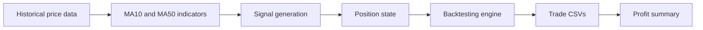

# Algorithmic Trading and Backtesting System

**Independent Python project | Historical data analysis | Modular backtesting**

A Python project for preparing historical equity prices, calculating moving-average indicators, generating long/short signals, simulating trade execution and exporting structured trade logs. The focus is **software architecture and research tooling**, not live automated trading or a claim of profitability.

**Technologies:** Python, pandas, NumPy, yfinance, requests, Alpha Vantage (for price quotes).

## System overview



The live price-alert function and the historical backtester are **separate parts of the project**. Price alerts compare a quote against a configured threshold; they do not use a trained machine-learning predictor.

## Project capabilities

- **Market data:** historical OHLC data via yfinance and individual quote requests via Alpha Vantage.
- **Indicators:** MA10, MA50, percentage price changes and a moving-average trend state.
- **Strategy:** +1 long / -1 short signal according to fast/slow moving-average values.
- **Simulation:** long and short positions, percentage stop-loss and take-profit logic, transaction fees and slippage assumptions.
- **Reporting:** per-symbol trade CSVs, a combined transaction log, run/error logs and profit summary exports.
- **Configuration:** tickers, interval, indicator names, risk settings and output file paths in `project/config.py`.

## Source structure

```text
Algorithmic-Trading-System/
├── README.md
├── project/
│   ├── Main.py                  # Interactive launcher
│   ├── config.py                # Strategy, risk and data settings
│   ├── modules/
│   │   ├── price_fetcher.py     # Alpha Vantage quotes, yfinance history
│   │   ├── indicators.py        # Moving averages and price features
│   │   ├── strategy.py          # Long/short signals and position states
│   │   ├── backtest.py          # Execution and trade accounting
│   │   ├── runner.py            # Orchestration and CSV export
│   │   └── utils.py             # Logging and data helpers
│   ├── data/
│   └── logs/
│       └── symbols.txt         # Instrument universe
└── .gitignore
```

The path references above describe the implementation. The repository also contains stored data/log artefacts; generated files may differ between runs.

## Signal generation

The strategy compares the shorter and longer moving averages at each data sample.

| Condition | Raw signal | Interpretation |
| --- | ---: | --- |
| MA10 > MA50 | +1 | Long |
| MA10 < MA50 | -1 | Short |
| MA10 = MA50 | 0 | Neutral |

The actual function in [`project/modules/strategy.py`](project/modules/strategy.py):

```python
def generate_signals(df):
    """
    generate_signals - generates +1, 0, -1 signals based
    on Fast_MA and Slow_MA crossovers
    """
    df["Signal"] = 0

    df.loc[df[Fast_MA] > df[Slow_MA], "Signal"] = 1
    df.loc[df[Fast_MA] < df[Slow_MA], "Signal"] = -1

    return df
```

`add_position()` carries the previous position forward whenever no new nonzero signal is generated. The strategy uses technical rules rather than statistical forecasting or machine learning.

## Risk and transaction assumptions

Values below are **current configuration settings**, not experimentally measured brokerage costs:

| Parameter | Configured value |
| --- | ---: |
| Moving averages | MA10 and MA50 |
| Initial simulated wallet | £1,000 |
| Allocation per trade | 5% of available balance |
| Stop-loss threshold | 2% |
| Take-profit threshold | 2% |
| Slippage assumption | 0.05% |
| Percentage fee | 0.1% |
| Fixed fee | 0.1 currency unit |
| Default historical interval | 1 hour |

The project keeps a list of **11 equities** in [`project/logs/symbols.txt`](project/logs/symbols.txt). The backtester allocates the initial balance by instrument before simulating each symbol separately.

## Execution and outputs

The command-line launcher, [`project/Main.py`](project/Main.py), offers six menu actions:

1. Run price-threshold alerts.
2. Run backtests.
3. Prepare indicators and signals.
4. Export a combined trade log.
5. Download historical data.
6. Generate a profit summary.

The source exports timestamps, symbol, entry/exit prices, position direction and simulated trade profit to CSV. The summary aggregates trade count, win rate, average wins/losses and other profit statistics.

## Setup and reproducibility status

The current source imports `pandas`, `numpy`, `yfinance` and `requests` and expects a **private Alpha Vantage key** through `from secrets import Alpha_Key` in `project/config.py`.

```bash
python -m pip install -r requirements.txt
python project/Main.py
```

**Important:** This documents the intended entry point, not a verified, one-command clean installation. A local secret module is required; never commit your API key. The current code also contains output-path differences between preparing analysis files and reading them for backtests. These require reconciliation before a fresh environment can reproduce all six menu actions reliably.

## Results and engineering interpretation

Original development notes describe historical tests using 11 equities and a rough **30–40% win rate** for certain runs. The old README contains separate illustrative numbers. Those figures are **not presented as a verified benchmark** because the exact data snapshot, configuration, run date and corresponding trade log are not linked together.

Win rate by itself does not establish strategy quality. A proper evaluation also requires profit factor, payoff distribution, maximum drawdown, trading costs, exposure, out-of-sample testing and comparison with a passive benchmark.

## Limitations and planned improvements

- Validate every cost, quantity and open-position-close accounting path with unit tests.
- Check signal timing and next-bar execution to avoid same-bar look-ahead bias.
- Make output paths consistent across preparation, simulation and reporting.
- Freeze historical datasets and export the full config with each run.
- Compare against a passive benchmark, then test out-of-sample and walk-forward periods.
- Add drawdown and equity-curve visualisations from reproducible trade logs.
- Introduce environment-variable-based API key loading before wider reuse.

**Status:** research/backtesting prototype. No live trading system, reproducible profitability claim or deployed trading service is represented here.

## Portfolio

[Engineering case study](https://farhan10904.github.io/engineering-portfolio/project.html?id=trading) · [Main engineering portfolio](https://farhan10904.github.io/engineering-portfolio/)
